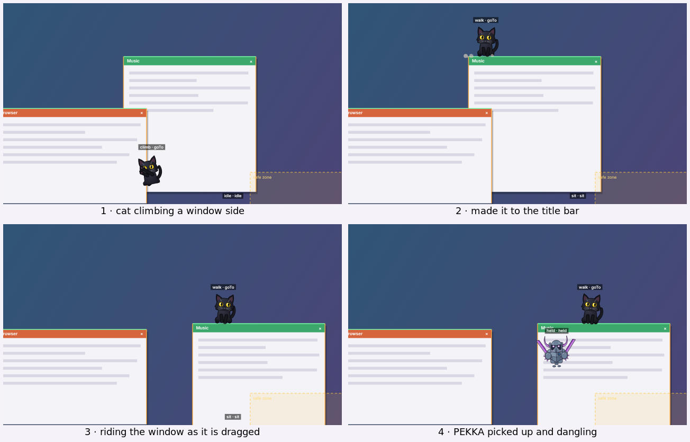

# Progress

## Stage 0: Setup and decisions ✅

- Electron 44, TypeScript (strict), Vite, esbuild, Vitest, Playwright, ESLint and Prettier set up.
- `DECISIONS.md` records the architecture, `README.md` covers how to run it.
- A transparent, frameless, always-on-top overlay covers the primary display's work area, so the taskbar stays uncovered. It never takes focus and is hidden from the taskbar.
- Click-through everywhere except over the creature. The renderer hit-tests the cursor with hysteresis and switches `setIgnoreMouseEvents` only when the state changes.
- Tray icon, drawn in code: Show/Hide, Quiet Mode, Debug Overlay, Creature Lab, Quit. Left-click toggles visibility.
- Settings are saved to a versioned JSON file with atomic writes and rotating backups.
- Debug overlay shows FPS (with an idle indicator) and the app's total CPU and RAM.
- Fixed-step loop that drops its frame rate when idle and pauses while hidden.
- Tests: unit tests for the event bus, RNG, math, loop, persistence, store and interactivity. Electron smoke tests for window properties, click-through and the tray (Show/Hide, Quiet Mode, Quit), run under Xvfb.

## Stage 1: The body ✅

- **Shared creature engine** for every character:
  - squash and stretch, hops with anticipation and dust on landing, pokes, a stiffness-scaled spring ring, optional verlet dangly chains, hover for floating characters
  - idle life from a seeded RNG: breathing, random blinks (sometimes double), eye saccades, fidgets (wiggle, bounce, sway, look around, wave, blep), yawns
  - nine blendable expressions (neutral, happy, sad, sleepy, surprised, annoyed, curious, excited, scared) on 16 face values, plus short reactions that fade back to the base mood
  - particles: sparkles, hearts, sweat, zzz, music notes, dust, "!", "?" and butterflies
- **Character system** (`src/creature/species/`): each character supplies its envelope, palettes (generic colour roles), stiffness, resting face bias and renderer. The lab has a character picker.
- **P.E.K.K.A (fan version)**, replicating the owner's reference art: rounded helmet with triangular eye sockets and ringed eyes, crescent horns, faceted chest plate with a gem plaque, spiked shoulder spheres, twin striped swords, far-apart disc feet. Five palettes: Reference Steel, Classic Violet, Arena Blue, Arena Red, Max Level Amber. Expressions show through the eye sockets (slant, size, squint, blink), a blush under the sockets, eye glints when excited, and the swords (raised when excited or surprised, sagging when sad or sleepy). Blink, yawn, fidgets, hop and poke all work. Screenshot tests cover all nine expressions, every palette, animations and particles at 1x and 2x.
- **Black Cat**, after the owner's reference: a clean black silhouette with big round yellow eyes, pointed ears and a tail that curls up beside it. Detailed expressions read from the shared face values:
  - eyes: pupils from thin slits (annoyed) to big round ones (excited, scared, pleading sad eyes), slanted upper lids, happy eyes shut in "^^" arcs (the owner's pick from five options, with no blush), iris fibres, catchlights, tears when sad, sparkles when excited; closed eyes as "^" (happy) or a lashed "u" (asleep)
  - ears perk, droop sideways when sad, go "airplane" when annoyed, pin flat when scared, one swivels when curious, and they twitch on their own
  - eyebrow whiskers and muzzle whiskers move with the mood (fanned when happy, drooping when sad, pulled back and trembling when scared)
  - `:3` mouth that frowns or wobbles, opens with fangs (a hiss when scared), yawns with a curled tongue, and bleps
  - tail is a physics chain: curled up when content, low when sad or sleepy, shoots up and bottle-brushes when scared, lashes when annoyed, quivers when excited; the body fur bristles when scared
  - front paws lift to "bunny paws" with toe beans when surprised or excited, and the wave fidget becomes a lucky-cat beckon
  - five palettes: Midnight (reference), Emerald Eyes, Copper Eyes, Odd Eyes, Smoke
  - screenshot tests cover all nine expressions, every palette, and yawn, blep, beckon, closed happy eyes and hop at 1x and 2x
- **Creature lab** (`npm run lab`, or "Creature Lab…" in the tray): character and palette pickers, expression buttons and blend sliders, manual face sliders, buttons for every animation, fidget, look direction and particle, background, zoom, slow motion, pause and step. Settings survive hot reloads.
- The overlay shows the character; click it to poke it. Quiet Mode dims it, calms fidgets and turns off particles.
- **History:** the first character, Glorp (a jelly blob), was removed at the owner's request, and the app was renamed **Desktop Buddy**.

## Stage 2: Movement and screen interaction ✅

- **The desktop as a world** (`src/world/`): each display's floor, the visible parts of window title bars (cut where other windows cover them), climbable window sides, and safe zones. A route planner links surfaces by walking, jumping, dropping off edges and climbing.
- **Movement** (`src/behaviors/mover.ts`): walking along surfaces, ballistic jumps, falls with squash on landing, clinging to and climbing window sides, riding a window while it is dragged, falling when it closes, minimises or gets covered, and bouncing off the edges of the desktop.
- **Behaviour state machine** (`src/behaviors/`): idle, walk, sit, sleep, climb, fall, jump, peek, hide, play, react and held. The next behaviour is picked by weighted chance when one finishes; reflexes cut in when the ground goes, the pet is grabbed, or the cursor dashes past.
- **Cursor play:** curious when it comes close slowly (a "?" and a look), follows it at a polite distance, pounces at it when it hovers near, gets startled and runs away when a fast cursor zooms past (never when it's heading for the pet: that's you reaching to grab it), stops and looks up while the cursor rests on it, and goes to sleep under a cursor that has been still for a while.
- **Drag and throw:** press and drag a pet to pick it up; it dangles from the cursor and swings like a pendulum, gets nervous if shaken, and flies off with your throw when you let go. A hard landing leaves it dizzy.
- **Both characters move in their own way.** The cat is quick and springy: it gets up off its haunches and trots on four legs, grips window edges with both paws, and hangs limp with its tail down when carried. PEKKA is slow and heavy, with alternating stomping feet, swinging swords and short jumps.
- **Both characters at once:** the tray's Characters menu turns each one on or off (both are on by default). They keep a little personal space.
- **Multiple monitors:** one overlay per display. Pets walk, fall or get thrown from one display to the next and are handed over between overlays, even mid-drag.
- **Windows window access** (`src/platform/win32/`): visible window rectangles and z-order through Win32 (via `koffi`), polled 4 times a second and 30 times a second for a window a pet is standing on. Titles and contents are never read. macOS and Linux have no window provider yet, so pets stay on the floors there.
- **Fullscreen apps and games:** the overlay on that display hides (or, if chosen in the tray, stays and goes quiet).
- **Safe zones:** pets never rest in the notification corner (on by default, toggled in the tray) or in custom zones from the settings file. The overlay covers only the work area, so the taskbar and its clock are never covered.
- **Quiet Mode** keeps pets on the ground: no climbing, jumping, running, pouncing, peeking or hiding, and more sitting and sleeping.
- **Playground** (`npm run playground`): a simulated desktop with two monitors at different heights, draggable fake windows, a safe zone and both characters, with each pet's state shown above it. It's where Stage 2 was built and checked.
- **Tests:** unit tests for the world, route planner, mover, brain and behaviours, including 12 simulated minutes on a desktop whose windows keep moving, closing and opening; playground tests for riding, closing, climbing, drag and throw and a 10-minute wander; screenshot tests for the walk, climb, carried and sleep poses of both characters; and Electron tests with two fake displays for riding, falling, hand-over between displays, fullscreen hiding, the Characters menu and drag and throw.

## Next

- Stage 3: Awareness (senses): system state, input activity rates, the focused app, and a privacy panel to see and toggle everything it observes.
- More characters when the owner names them.

## Known issues

- On Linux, `setIgnoreMouseEvents(..., { forward: true })` does not forward mouse moves, so hover detection relies on main's 30 Hz cursor polling. Windows and macOS get both.
- Under X11 with no window manager (CI), the overlay comes out 1px smaller than the work area. The test allows for it.
- Performance is not measured on Windows yet. In the Linux dev container (Xvfb, software GL) the debug overlay showed about 11% CPU and 556 MB summed across all Electron processes, far above the budget (under 3% idle CPU, 150 MB RAM). Those numbers include software rendering and aren't representative, but the budget is unproven until it's measured on real Windows hardware. Stage 9 covers profiling and cuts (lighter idle loop, GPU flags, process count).
- **The Win32 window provider has not run on a real Windows machine yet** (this environment is Linux). Its filtering logic is unit-tested and the rest of Stage 2 is tested with fake windows, but the first run on Windows may need fixes to which windows count (for example, apps with unusual window styles).
- On macOS and Linux there is no window provider yet, so pets only use the floors.
- While a pet is dragged onto another display, that display follows the cursor at main's 30 Hz poll rate, so the drag looks a little less smooth there.
- Screenshot baselines are kept per platform (`e2e/__screenshots__/<platform>/`). Only Linux baselines are committed, so on Windows run `npm run test:e2e:update` once to record local ones.
