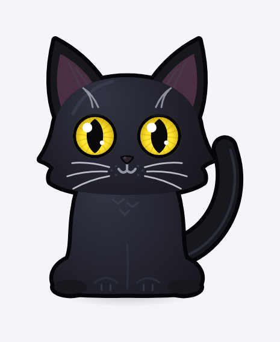
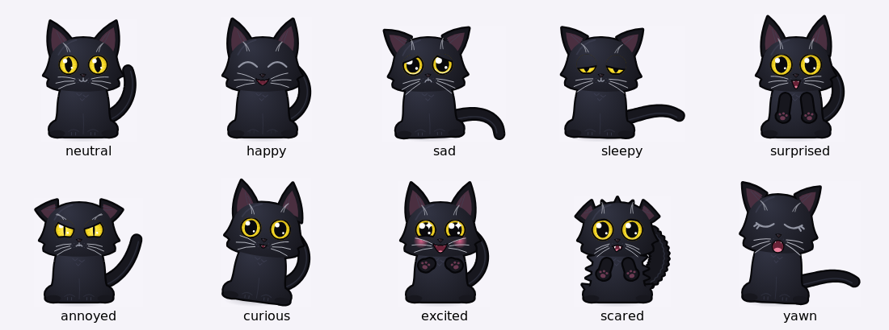
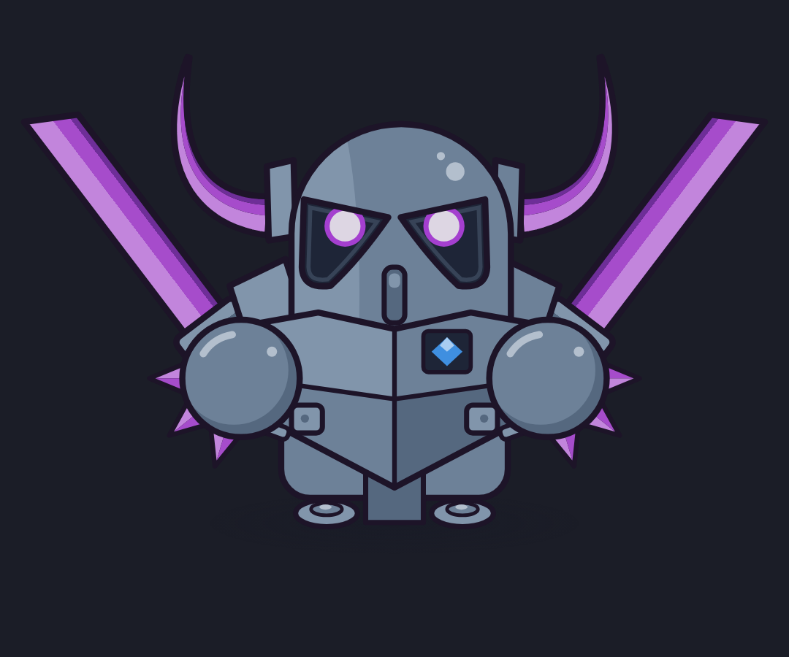
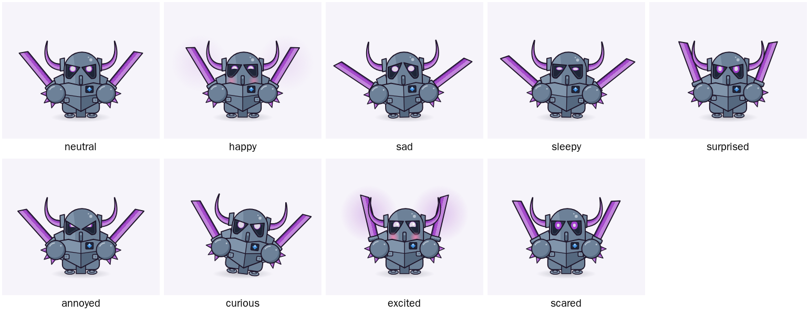

# Desktop Buddy

A living desktop companion. Characters are drawn entirely in code and live on top of your desktop in a transparent window. Clicks pass straight through everywhere except on the character itself.

There are two characters so far. A small **black cat** with big yellow eyes:



Its expressions are cat body language: pupils go to slits or dilate, eyelids slant, ears perk up, swivel or flatten, whiskers fan out or pull back, the `:3` mouth opens to show fangs, and the tail curls, droops, lashes or puffs up:



And a fan version of **P.E.K.K.A** from Supercell's Clash games:



She has every expression the engine supports:



> Status: early development. See [`PROGRESS.md`](PROGRESS.md) for what works today and [`DECISIONS.md`](DECISIONS.md) for why things are built the way they are.

## Requirements

- Node.js 22+
- Windows 10/11 (main target). macOS and Linux run but have fewer OS integrations.

## Getting started

```bash
npm install
npm run dev      # Electron + hot reload (renderer HMR, main/preload auto-restart)
```

Your buddies appear at the bottom of your primary screen and start living there: wandering, sitting on window title bars, climbing window sides, peeking in from the screen edges, napping, playing with your cursor. Drag one to pick it up and let go to throw it. There is an icon in the system tray:

| Tray item                         | What it does                                                                        |
| --------------------------------- | ----------------------------------------------------------------------------------- |
| Hide / Show Buddy                 | Removes the character from the desktop (left-clicking the tray icon does the same). |
| Quiet Mode                        | The characters dim, stay on the ground and keep calm.                               |
| Characters                        | Turn each character on or off (both are out by default).                            |
| When a Fullscreen App Is Open     | Hide (default) or stay but go quiet.                                                |
| Keep Clear of Notification Corner | Pets won't rest where notifications pop up.                                         |
| Debug Overlay                     | FPS, CPU and RAM in the top-left corner.                                            |
| Creature Lab…                     | Opens the lab, with sliders and buttons for every expression and animation.         |
| Quit Desktop Buddy                | Exits.                                                                              |

The **creature lab** has a character picker plus buttons and sliders for every expression, animation, particle and palette. Click the character there to poke it. To work on visuals in a plain browser without Electron:

```bash
npm run lab          # opens http://localhost:5173/lab/index.html
npm run playground   # a simulated desktop (two monitors, draggable windows) with both characters
```


## Scripts

| Script                    | Purpose                                                                                                     |
| ------------------------- | ----------------------------------------------------------------------------------------------------------- |
| `npm run dev`             | Development app with hot reload.                                                                            |
| `npm start`               | Production build, then launch.                                                                              |
| `npm run lab`             | Creature lab in the browser.                                                                                |
| `npm run playground`      | Simulated desktop for watching and testing movement and behaviour.                                          |
| `npm test`                | Unit tests (Vitest).                                                                                        |
| `npm run test:e2e`        | Playwright: lab screenshots at 1x and 2x, plus Electron smoke tests. On Linux CI, wrap it in `xvfb-run -a`. |
| `npm run test:e2e:update` | Re-record screenshot baselines (do this on your own machine after an intentional visual change).            |
| `npm run check`           | Typecheck, lint, format check and unit tests.                                                               |

## Privacy

Everything stays on your machine. Desktop Buddy never records what you type, what is on screen, or your clipboard. To let the pets use your windows as furniture it reads only window rectangles and their stacking order, never titles or contents. Senses that read activity (added in later stages) report **rates only** and can each be switched off.

## Fan content

P.E.K.K.A is © Supercell. This project is non-commercial fan content and is not affiliated with, endorsed, sponsored or approved by Supercell. See [Supercell's Fan Content Policy](https://supercell.com/en/fan-content-policy/).
